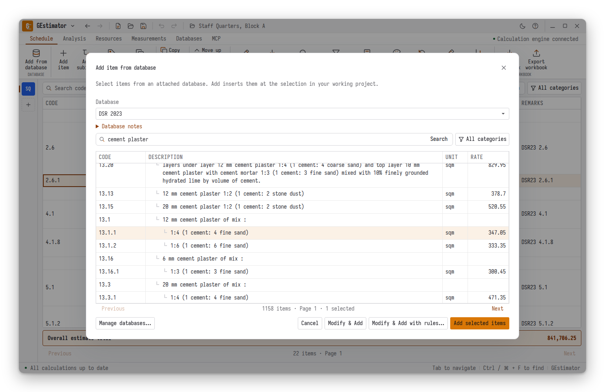
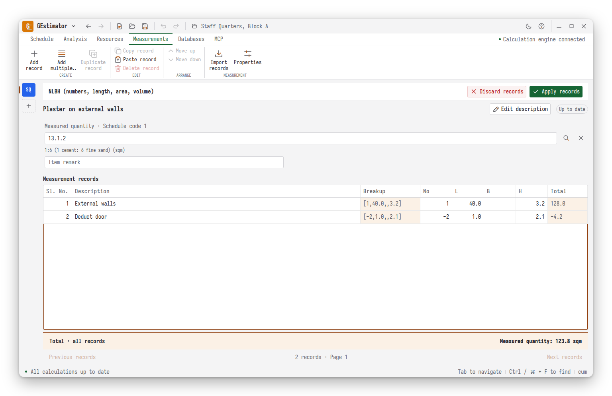

# GEstimator

[Website](https://manuvarkey.github.io/GEstimator) • 
[Forum](https://github.com/manuvarkey/GEstimator/discussions/) •
[Bug tracker](https://github.com/manuvarkey/GEstimator/issues) •
[Git repository](https://github.com/manuvarkey/GEstimator)

[](https://github.com/manuvarkey/GEstimator/releases/latest)


<a href="https://github.com/manuvarkey/GEstimator/releases/latest"> </a>
<a href="https://flathub.org/apps/com.kavilgroup.gestimator"> </a>
<a href="https://snapcraft.io/gestimator"> </a> 

GEstimator prepares cost and quantity estimates of civil and electrical works with detailed rate analysis. It comes bundled with **DSR 2023 (Civil)**, **DSR (E&M) 2025** and **DSR 2025 Horticulture**, and works with any number of your own databases.


## Features

- **Schedule** of estimate items, added from a database, entered directly or imported from a `.xlsx` workbook. Items keep their rate analysis, so every rate stays traceable.
- **Rate analysis** editor with resource groups, subtotals, weighted additions (CP&OH, GST, cess), multipliers and rounding. Changing a resource rate updates every dependent item. Bulk edit rules change many analyses at once with a preview.
- **Resources** (materials, labour, plant) shared by all analyses, with usage reports and rate refresh from a newer database.
- **Measurements** recorded against schedule items with templates (NLBH, steel reinforcement, electrical points, ducting), expressions in cells and automatic quantity update.
- **Databases** attached read-only, with notes on how each is organised and what its rates include.
- **Export** of the whole estimate to a `.xlsx` workbook: schedule of rates, schedule of resources, details of measurements, resource usage and analysis of rates.
- **Several projects in tabs**, unlimited undo, light and dark themes, and recovery of unsaved work after a crash.
- **AI assistants** (optional): a local [MCP](https://modelcontextprotocol.io) server lets Claude or any MCP client read and prepare estimates in the open project.

## User manual

The [user manual](docs/manual/README.md) walks through the whole workflow with screenshots, using a sample estimate priced from DSR 2023.

| | |
|---|---|
|  |  |
|  |  |

## Databases

DSR 2023 (Civil), DSR (E&M) 2025 and DSR 2025 Horticulture are bundled. Older schedules and other databases (DSR 2016–2021, DSR (E&M) 2016–2022, market rate databases) can be downloaded from [Other databases](https://github.com/manuvarkey/GEstimator/tree/master/Other%20databases). Any GEstimator project (`.eproj`) can be attached as a database.

## Installation

Installers for Windows (`.exe`) and Linux (`.deb`, `.AppImage`, Flatpak and Snap) are published under [Releases](https://github.com/manuvarkey/GEstimator/releases/latest).

On Windows, uninstall any 2.x version of GEstimator (Settings → Apps) before installing 3.0. The new installer does not remove it.

Version 2.7, the last release of the earlier GTK application, remains available under [Releases](https://github.com/manuvarkey/GEstimator/releases/tag/v2.7); its source is on the [`archive/gtk`](https://github.com/manuvarkey/GEstimator/tree/archive/gtk) branch.

## Building from source

The application is a [Tauri](https://tauri.app) desktop program (`modern/`) with a Vue interface and a Python backend (`modern/backend`, using the calculation engine in `estimator/`). It needs Python 3.14, Node.js 22 or later, Rust and the [Tauri prerequisites](https://v2.tauri.app/start/prerequisites/). See [modern/README.md](modern/README.md) for development and Windows builds.

```sh
python3 -m venv .venv
.venv/bin/pip install -r requirements.txt pyinstaller==6.22.3
npm ci --prefix modern
npm run --prefix modern bundle:backend
npm run --prefix modern tauri -- build
```

Release packages are built by the [Release workflow](.github/workflows/release.yml) on a version tag. The Flatpak builds from source (`packaging/flathub`, the manifest used by Flathub); the Snap (`snapcraft.yaml`) repackages the Linux `.deb`.

For contributions, follow [AGENTS.md](AGENTS.md), the
[development guidelines](docs/development-guidelines.md) and the
[repository quality audit](docs/code-quality-audit.md). The
[Code quality workflow](.github/workflows/quality.yml) checks changed-file
formatting, backend tests, frontend builds, browser workflows and native Rust code.
