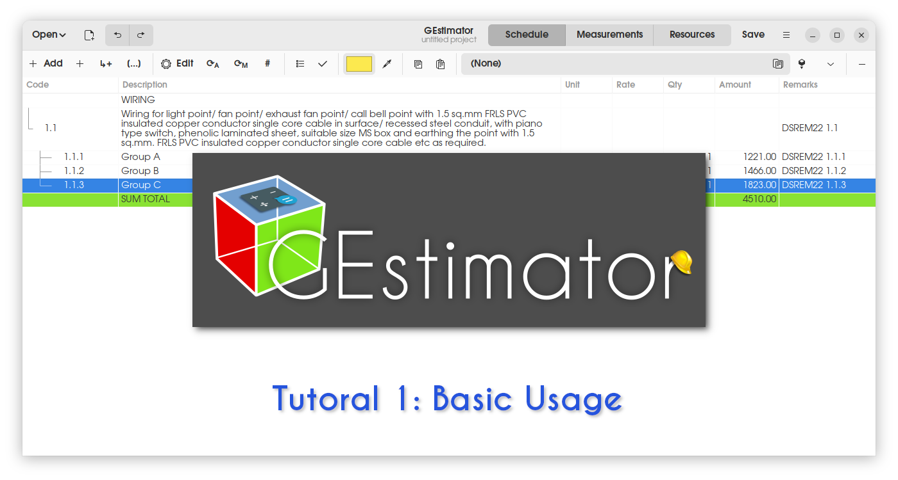
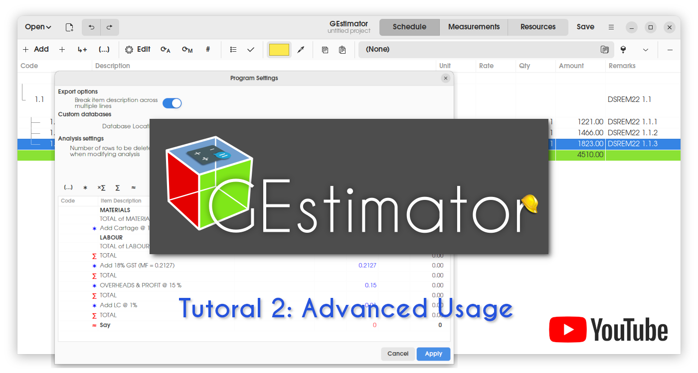
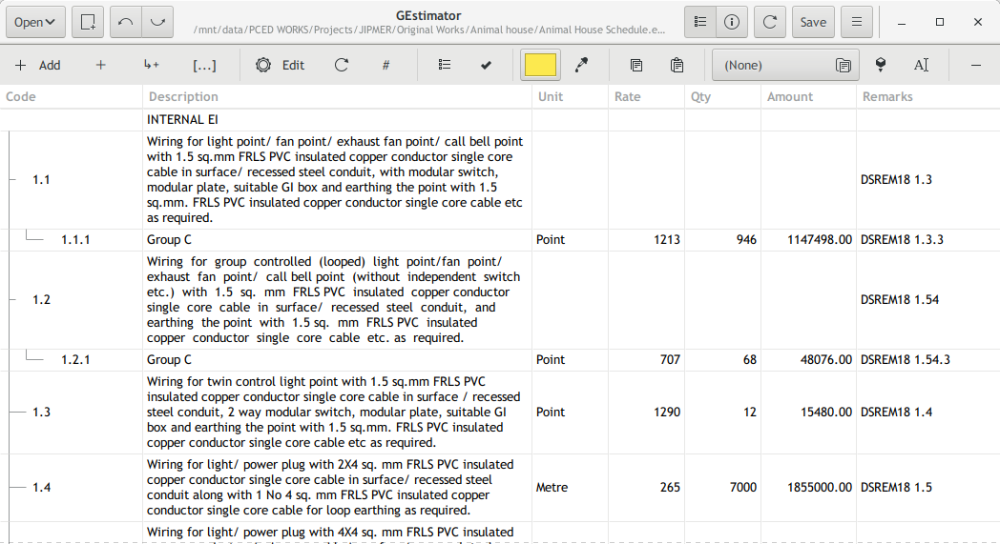
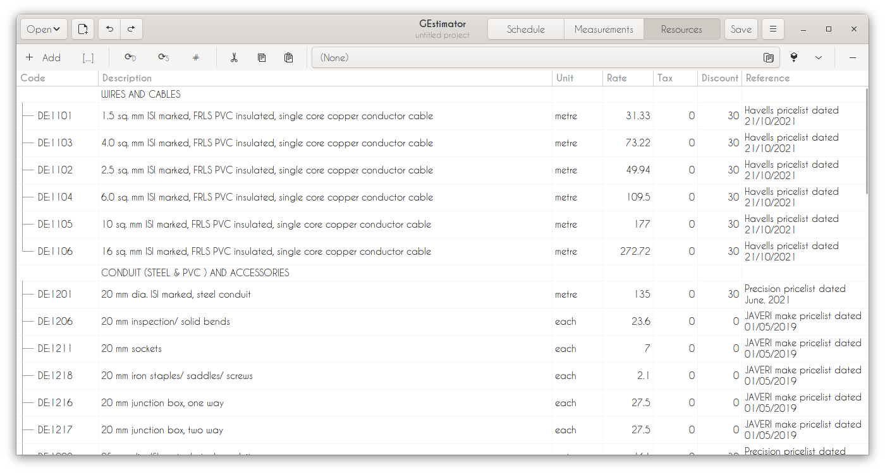
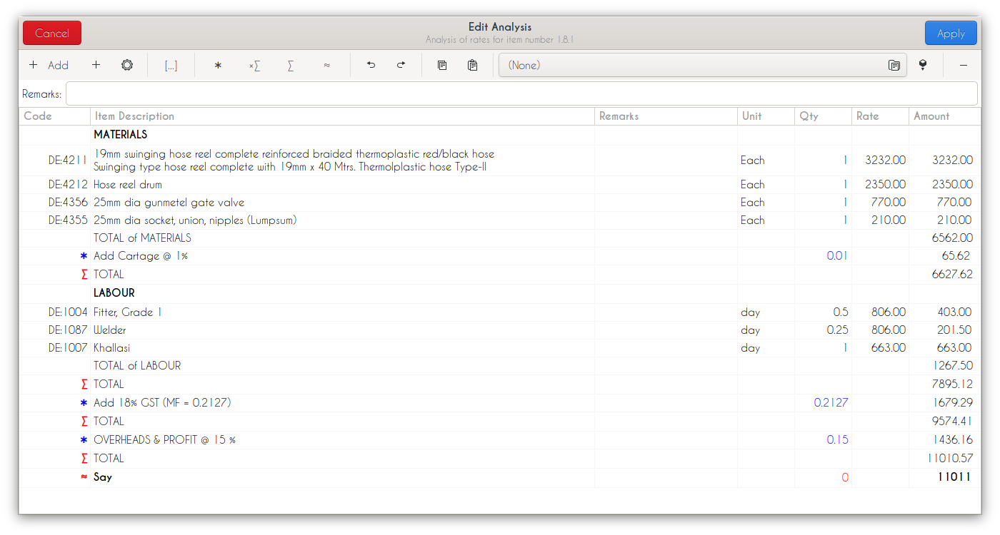
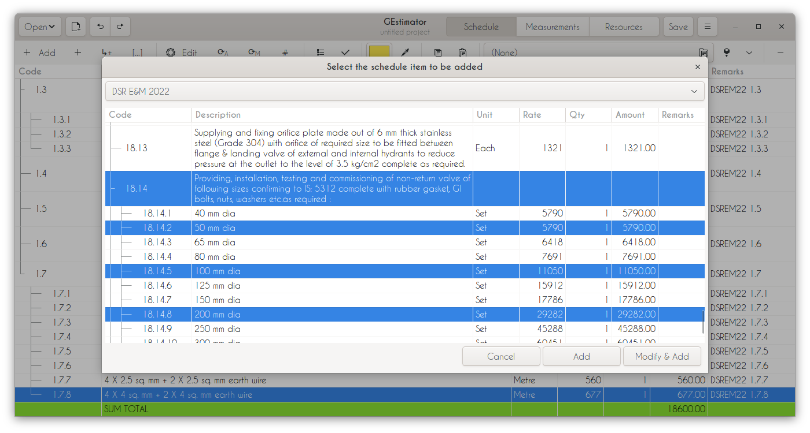
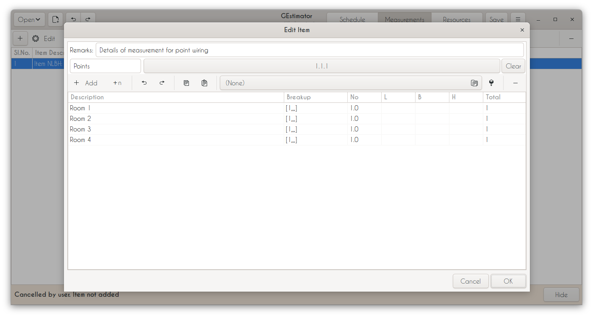

# GEstimator

[Website](https://manuvarkey.github.io/GEstimator) • 
[Forum](https://github.com/manuvarkey/GEstimator/discussions/) •
[Bug tracker](https://github.com/manuvarkey/GEstimator/issues) •
[Git repository](https://github.com/manuvarkey/GEstimator)

[](https://github.com/manuvarkey/GEstimator/releases/latest)


<a href="https://github.com/manuvarkey/GEstimator/releases/latest"> </a>
<a href="https://beta.flathub.org/apps/com.kavilgroup.gestimator"> </a>
<a href="https://snapcraft.io/gestimator"> </a> 

GEstimator is a civil estimation software for preparing cost and quantity estimates of civil/electrical works along with detailed rate analysis. It supports multiple user databases and comes bundled with **DSR 2021 (Civil)** and **DSR (E&M) 2025**.

The program is organised in Schedule, Resources and Measurements views. Schedule holds the estimate items, entered directly, added from a database or imported from a .xlsx file; opening an item's analysis shows the rate analysis editor. Measurements records the details of measurements against schedule items. Resources holds the materials, labour and tools/plants on which the rate analyses are framed. Several projects can be open in tabs, and unsaved work is recovered after a crash.

The estimate can be exported to a .xlsx workbook containing the schedule of rates, schedule of resources, details of measurements, resource usage and the analysis of rates for each item. An optional local MCP server lets AI assistants read and prepare estimates.

The earlier GTK application (version 2.x) is kept on the [`archive/gtk`](https://github.com/manuvarkey/GEstimator/tree/archive/gtk) branch.


## Tutorials

[](https://youtu.be/B3ycfivex-E)

[](https://youtu.be/lo3-QIPtyI8)

## Screenshots







## Resources
Additional libraries and other resources can be downloaded from [GEstimator Other Databases](https://github.com/manuvarkey/GEstimator/tree/master/Other%20databases).

## Installation

Installers for Windows (`.exe`) and Linux (`.deb`, `.AppImage`, Flatpak and Snap) are published under [Releases](https://github.com/manuvarkey/GEstimator/releases/latest).

## Building from source

The application is a [Tauri](https://tauri.app) desktop program (`modern/`) with a Vue interface and a Python backend (`modern/backend`, using the calculation engine in `estimator/`). It needs Python 3.14, Node.js 22 or later, Rust and the [Tauri prerequisites](https://v2.tauri.app/start/prerequisites/). See [modern/README.md](modern/README.md) for development and Windows builds.

```sh
python3 -m venv .venv
.venv/bin/pip install -r requirements.txt pyinstaller==6.22.3
npm ci --prefix modern
npm run --prefix modern bundle:backend
npm run --prefix modern tauri -- build
```

Release packages are built by the [Release workflow](.github/workflows/release.yml) on a version tag. Flatpak and Snap recipes are in `packaging/flatpak` and `snapcraft.yaml`; both repackage the Linux `.deb`.
