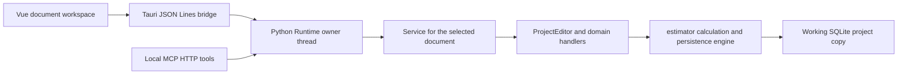

# Application architecture

Current contract, checked against source on 2026-11-23.
Navigation: [documentation index](../README.md) · [development workflow](../development-guidelines.md)
· [verification](../testing.md).

## Layers and ownership

GEstimator is a Vue/TypeScript desktop interface hosted by Tauri, with one
persistent Python backend process per desktop application process. Each open
document has its own backend `Service`; one `Runtime` thread serializes access
to all of them. The MCP listener is shared and acts on the active document.
The GTK UI is retained on the `archive/gtk` branch; the shared calculation
engine remains in this checkout under `estimator/`.

| Layer | Owns | Must delegate |
| --- | --- | --- |
| Vue | Input, view state, selection, dialogs, focus and rendering | Calculations, validation and writes to Python |
| Rust/Tauri | Native commands, project-open events, sidecar lifecycle and transport | Domain decisions to Python; navigation guards to the workspace |
| Python runtime/service | Sessions, serialized requests, revisions, drafts and command routing | Engine semantics to `estimator/` |
| Python domain handlers | Imports, placement, measurement edits, rates and search | Transaction/history ownership to the editor/service |
| Shared engine | Models, rate/measurement calculation, ORM and workbook output | UI behavior to adapters |

The engine must not import `modern` or UI dependencies. A domain feature does
not gain an alternative persistence path because it is exposed through MCP.
Read [backend architecture](backend.md) before changing a command or write path.

## Contract map

- [Database format](database-format.md): physical tables, serialized measurements,
  optional metadata, file compatibility and safe save behavior.
- [Backend](backend.md): module ownership, JSON Lines protocol, revisions,
  transaction boundaries, calculations, numeric expressions and regression tests.
- [Frontend](frontend.md): document/view lifetimes, shared components, editor
  behavior, guarded navigation, native events and refresh coordination.
- [MCP](mcp.md): public tool surface, access checks, resources, result envelopes,
  read-only SQL and desktop synchronization.

## A normal write

1. The active Vue workspace submits a command through
   [`backend.ts`](../../modern/src/backend.ts), including its session and the
   latest revision when required.
2. Rust sends one JSON Lines request to the Python sidecar and matches the reply
   by request ID. [`Runtime`](../../modern/backend/runtime.py) chooses the session
   and executes the request on its owner thread.
3. `Service.call` and `ProjectEditor.call` validate the request and protect dirty
   drafts. Domain handlers reuse the engine under the existing mutation or
   compound transaction boundary.
4. The backend returns authoritative state/results. Vue refreshes the affected
   data while retaining valid selection, focus and scroll state.
5. Apply changes the working project; Save publishes a project file. Recovery
   checkpoints include pending drafts without replacing their live histories.

MCP writes enter the same application operations after their own schema/access
checks. MCP reporting reads stored working-project data, not unsaved desktop
drafts. These distinctions are detailed in the [MCP contract](mcp.md).

## Native shell

[`main.rs`](../../modern/src-tauri/src/main.rs) starts the development Python
interpreter or packaged sidecar, serializes bridge requests under a mutex,
correlates replies and forwards progress events. Transport failure drops the
backend connection; process cleanup kills and reaps the child. Preserve these
ownership and cleanup paths when extending native integration.

[`project_open.rs`](../../modern/src-tauri/src/project_open.rs) queues launch and
single-instance file-open requests. [`projectOpening.ts`](../../modern/src/projectOpening.ts)
drains them and handles drops through the workspace's unsaved-work guard. Do not
open a project directly from a second native event path. Platform font handling
is adapter code; it must not become an engine dependency.

[`tauri.conf.json`](../../modern/src-tauri/tauri.conf.json) and the
[capabilities](../../modern/src-tauri/capabilities/default.json) define the native
surface. [`bundle_backend.py`](../../modern/bundle_backend.py) packages the Python
sidecar separately on each target platform. Build commands are maintained in the
[developer README](../../modern/README.md); native acceptance checks are in the
[testing guide](../testing.md).

## Extending the application

Choose the owner before editing. Keep shell components and routers small by
extracting a new concern into a named helper/composable rather than growing
`App.vue`, `ProjectViews.vue`, `project.py` or `service.py`. Preserve public
forwarding methods where they keep callers stable. Avoid parallel calculations,
hidden state mixins and splits that only divide a long file into numbered parts.

Use the [quality audit](../code-quality-audit.md) to identify existing hotspots,
the [development workflow](../development-guidelines.md) for change review, and
the [roadmap](../roadmap.md) for genuinely unfinished work. Historical migration
documents explain past decisions; they do not override these current contracts.
