# GEstimator user manual

For application development, start with the [developer documentation index](../README.md).

GEstimator prepares cost and quantity estimates of civil and electrical works with detailed rate analysis. This manual walks through the workflow with a sample estimate: a small staff quarters building priced from the bundled DSR 2023 (Civil) database.

- [1. The workspace](#1-the-workspace)
- [2. Start or open a project](#2-start-or-open-a-project)
- [3. Attach a database](#3-attach-a-database)
- [4. Build the schedule](#4-build-the-schedule)
- [5. Check and edit rate analyses](#5-check-and-edit-rate-analyses)
- [6. Manage resources and rates](#6-manage-resources-and-rates)
- [7. Record measurements](#7-record-measurements)
- [8. Import from and export to Excel](#8-import-from-and-export-to-excel)
- [9. Save, tabs and recovery](#9-save-tabs-and-recovery)
- [10. Settings](#10-settings)
- [11. Use an AI assistant (MCP)](#11-use-an-ai-assistant-mcp)
- [12. Keyboard shortcuts](#12-keyboard-shortcuts)

## 1. The workspace

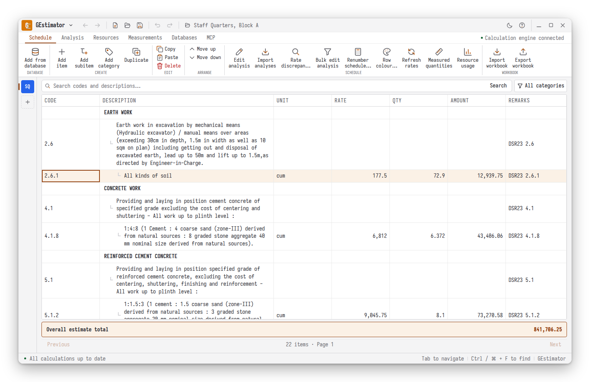

- **Title bar:** application menu, back and forward, new, open and save, undo and redo, the project name, theme and keyboard shortcuts.
- **View tabs:** Schedule, Analysis, Resources, Measurements, Databases and MCP. The ribbon below the tabs shows the tools of the current view.
- **Project rail** (left edge): one tile for each open project. Click a tile to switch projects; `+` opens a new tab.
- **Type-ahead:** type while a table has focus (Schedule, Resources, database picker) to jump to the first row containing every word you type. Rows are not filtered; **Up**/**Down** move between matches and **Esc** closes the find box. From the search field, **Up**/**Down** move through the listed rows.
- **Table:** the rows of the current view. A search field and category filter sit above it; the estimate total and page controls sit below it.
- **Status bar:** calculation status, unsaved drafts and hints.

Click a cell to select it and double-click or press Enter or F2 to edit it. While editing, press Enter to save the current cell, Tab to save and edit the next cell, or Escape to cancel. Ctrl+click and Shift+click select several rows. Right-click a row for its context menu.

Light is the default theme. Use the moon icon in the title bar to switch to dark.

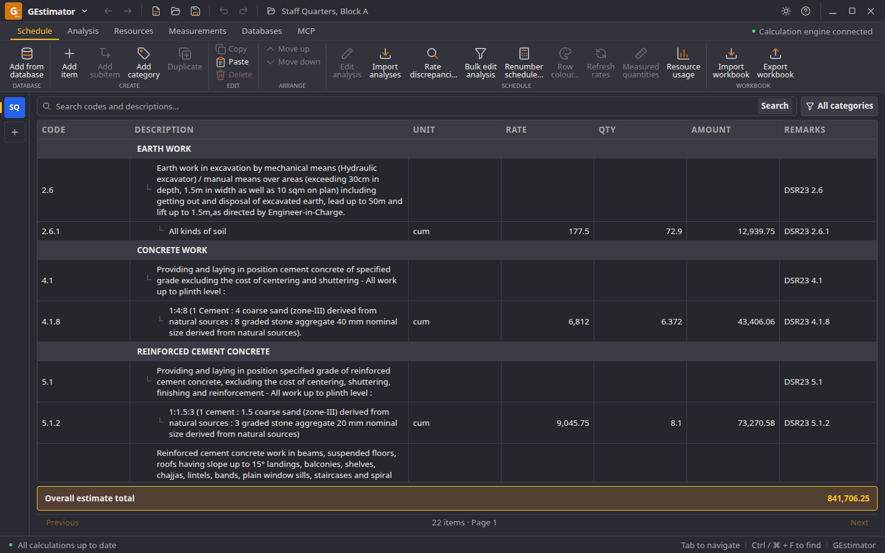

## 2. Start or open a project

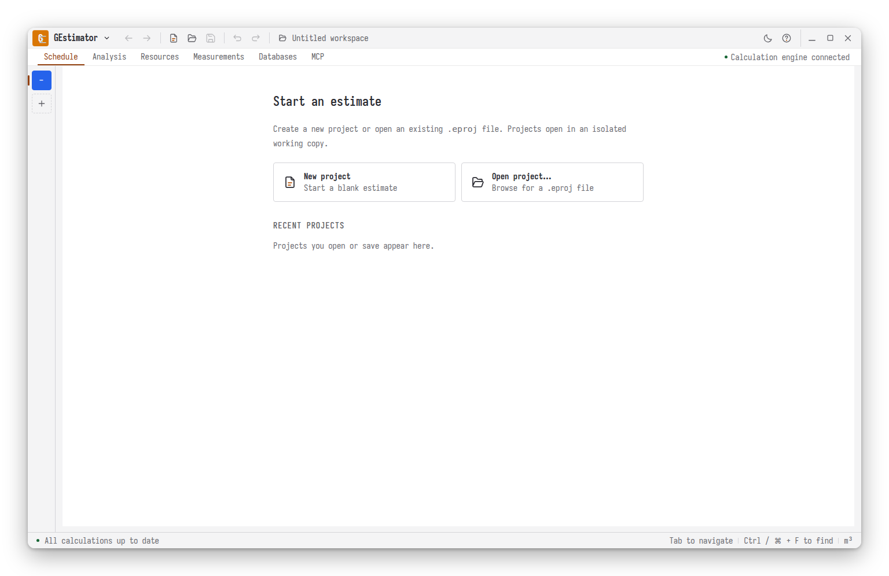

With no project open, the Schedule view shows the start page:

- **New project** starts a blank estimate.
- **Open project…** opens an existing `.eproj` file. Recent projects are listed below for one-click opening.

GEstimator edits an isolated working copy of the project. The file on disk changes only when you save (see [section 9](#9-save-tabs-and-recovery)).

Give the estimate a name and code prefixes in **Project settings** (application menu). Project settings also hold free-form project notes.

## 3. Attach a database

A database is any `.eproj` file whose items and resources you copy into your estimate. GEstimator comes with:

- **DSR 2023** – CPWD Delhi Schedule of Rates 2023 (Civil) with Delhi Analysis of Rates 2023.
- **DSR (E&M) 2025** – CPWD Delhi Schedule of Rates (E&M) 2025 with its analyses.
- **DSR 2025 Horticulture** – CPWD Horticulture and Landscaping 2025.

Databases are opened read-only: nothing you do in an estimate changes them. Older schedules (DSR 2016–2021, DSR (E&M) 2016–2022 and others) can be downloaded from [Other databases](https://github.com/manuvarkey/GEstimator/tree/master/Other%20databases).

The bundled databases and every `.eproj` file in your database folder are attached automatically each time a project opens. Use **Attach database…** only for other databases:

1. Open the **Databases** tab and click **Attach database…**.
2. Enter or browse to a `.eproj` file under **Library project**.
3. Keep **Remember for future projects** ticked to attach it automatically next time.
4. Click **Attach library**.

In the Flatpak build, use **Browse** to grant access to an external library.
If a remembered library becomes unavailable, choose **Reselect** to update
its location. A database that uses a SQLite write-ahead log needs a
standalone SQLite backup for single-file attachment.

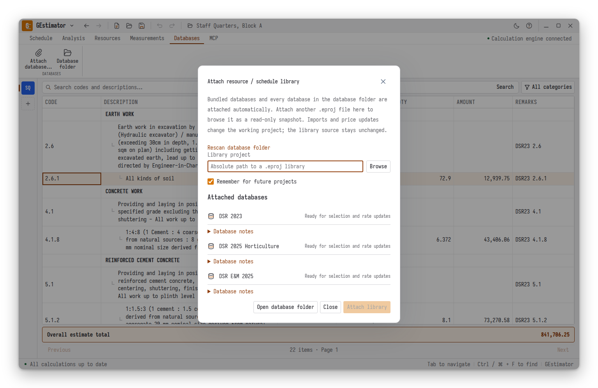

**Database folder** opens the folder for your own databases. A `.eproj` file placed there is attached the next time a project opens, or use **Rescan database folder** in the dialog.

## 4. Build the schedule

The Schedule holds the items of the estimate: code, description, unit, rate, quantity, amount and remarks. Items are grouped in categories; an item can have subitems, and a heading row carries the common description of its subitems.

### Add items from a database

1. In **Schedule**, select the row after which the new items go.
2. Click **Add from database** (Ctrl+L).
3. Choose the database, search for the work (for example `cement plaster`) and narrow the list with **All categories** if needed.
4. Select one or more items (Ctrl+click or Shift+click) and click **Add selected items**.

In the Schedule and Resources database pickers, press Up or Down from the
search field to move into the results. Use Shift+Up or Shift+Down to select a
range, then press Enter to add the selected items.
In Schedule, Enter uses **Modify & Add**. Use Ctrl+Enter (Command+Enter on
macOS) to add the selected schedule items with their original rates and analysis.

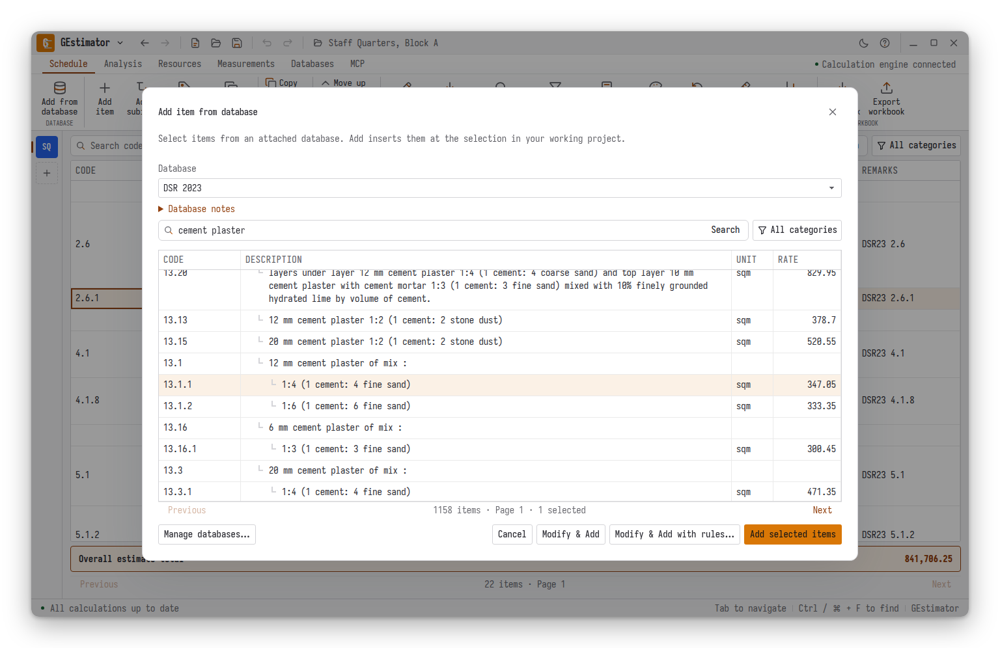

GEstimator copies each item with its rate analysis, the resources the analysis uses and any parent headings, so every rate stays traceable. Codes of imported resources carry the database prefix (for example `DC23:0367`) so that the same resource from two databases stays one row.

- **Modify & Add** applies the schedule rate multiplier and analysis-row replacements from Program Settings.
- **Modify & Add with rules…** applies bulk analysis rules while adding (see [section 5](#5-check-and-edit-rate-analyses)).
- **Database notes** explains how the database is organised, what its rates include and how to pick the right item. Read them before using a database for the first time.

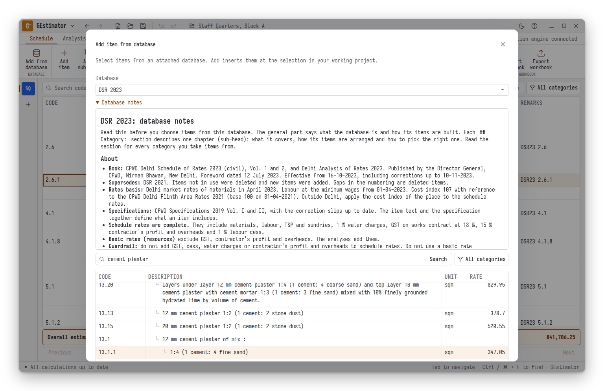

### Enter items directly

- **Add item** (Ctrl+I) adds an item in the selected category; **Add subitem** (Ctrl+Shift+I) adds a child of the selected item.
- **Add category** inserts after the category containing the last selected row. With no selection, it creates the first category. This also applies in Resources and Measurements. Use **Duplicate**, **Copy**, **Paste**, **Delete**, **Move up** and **Move down** to rearrange rows. Rows copied in one GEstimator window paste into another.
- Edit any cell in place. Type quantities directly, or let measurements fill them (see [section 7](#7-record-measurements)).
- **Renumber schedule…** renumbers item codes in order; **Row colour** highlights rows; **Rate discrepancies** lists items whose stored rate differs from their analysis.

The **Overall estimate total** below the table always covers the whole project, whatever the search or filter shows.

## 5. Check and edit rate analyses

Select an item and click **Edit analysis** to open its rate analysis. The Project explorer on the left lists the schedule items and resources for quick reference.

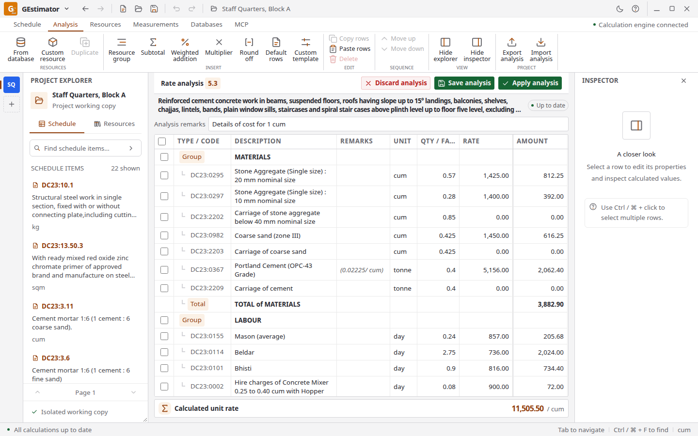

An analysis is a list of rows, calculated from top to bottom:

| Row | Meaning |
|---|---|
| **Group** | A heading such as MATERIALS or LABOUR, followed by resource rows (code, quantity, rate, amount) and a group total. |
| **Subtotal** | Sums the rows above it and becomes the base for the next rows. |
| **Weighted addition** | Adds a fraction of the base, for example `Add CP&OH @ 15%` (0.15) or water charges (0.01). |
| **Multiplier** | Replaces the running total with the base multiplied by a factor, for example to divide a lot rate by its quantity. |
| **Round off** | Rounds the running total, for example to the nearest 0.05. |

- Add resources with **From database** (resources of an attached database) or **Custom resource**. Insert calculation rows with the ribbon buttons; **Default rows** inserts your standard additions and **Custom template** your saved templates.
- The **Calculated unit rate** at the bottom updates as you edit. The **Inspector** on the right shows the properties and calculated values of the selected row.
- **Apply analysis** accepts the draft into the project, updates the item rate and every rate that depends on it, and returns to Schedule. **Discard analysis** abandons the changes.
- **Export analysis** and **Import analysis** exchange single analyses with Excel workbooks.

### Bulk edit analyses

**Bulk edit analysis** (Schedule ribbon) changes many analyses at once with rules: for example set the CP&OH row to 10 % in every selected item, replace a resource, or delete water charges. Conditions select rows by kind, description, code or value. Preview shows every change before you apply it, and the whole edit is one undo step. Rule sets can be saved as presets.

## 6. Manage resources and rates

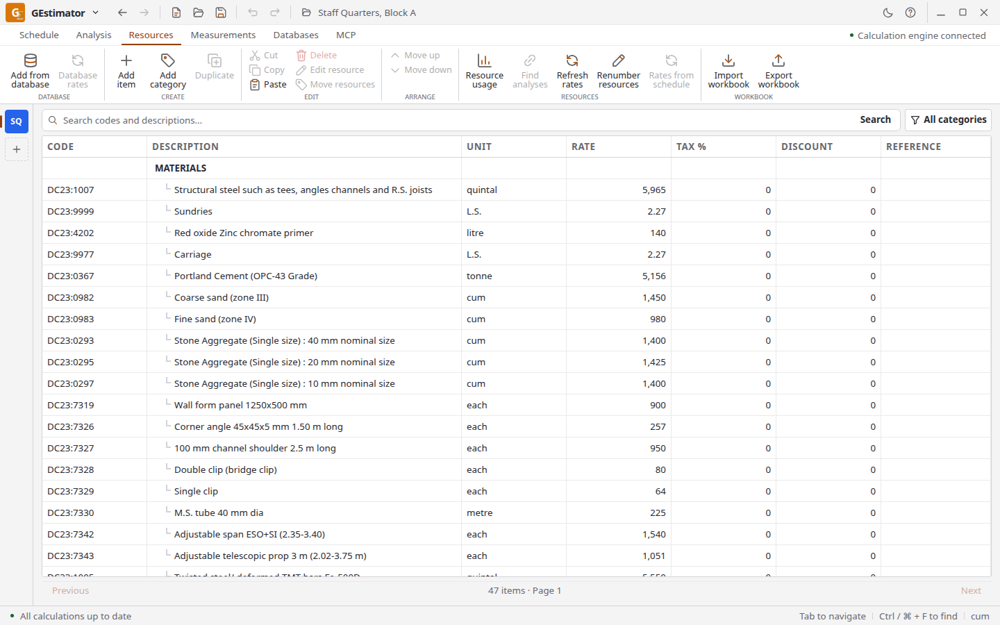

Resources are the materials, labour and plant on which analyses are built. Each resource has a code, description, unit, rate, tax %, discount and reference. Changing a resource rate updates every analysis and item that uses it.

- **Add from database** copies resources from an attached database.
- **Database rates** refreshes the rates of the selected resources from a database (for example a newer schedule), with a preview before applying.
- **Resource usage** shows which items use a resource and how much of it the estimate consumes; **Find analyses** jumps to them.
- **Refresh rates** recalculates every item rate from its analysis.
- **Move resources**, **Cut** and **Paste** reorganise resources between categories; **Renumber resources** renumbers codes.

## 7. Record measurements

Measurements record the detailed dimensions behind each quantity.

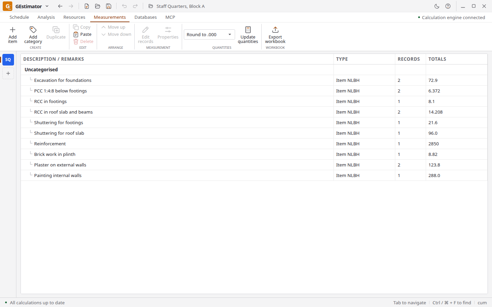

1. In **Measurements**, click **Add measurement** and choose a template. The new item goes after the last selected measurement, first within a selected category, or at the top without a selection. **NLBH (numbers, length, area, volume)** suits most civil items. Other templates cover several linked quantities, steel reinforcement, electrical points and round or rectangular ducting.
2. Double-click the measurement (or click **Edit records**) to open its records.
3. Link the measurement to a schedule item under **Measured quantity**: type or search the item code.
4. Add records with **Add record** (Ctrl+I) or **Add multiple records**, and fill in the dimensions. Cells accept arithmetic such as `2*3.5+1.2`. A negative number deducts, for example a door opening.
5. Click **Apply records**.

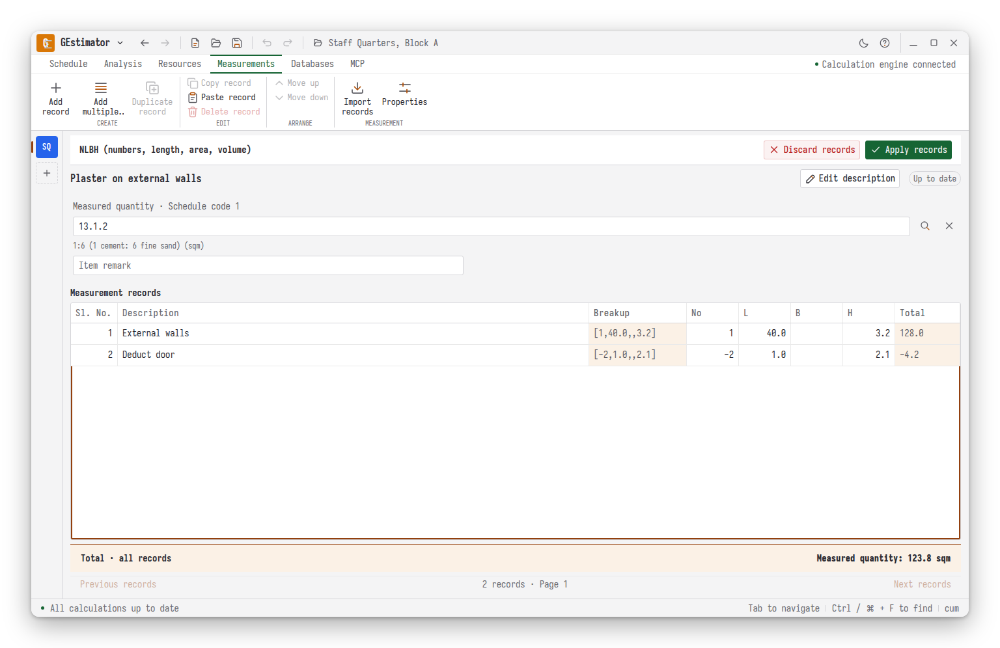

When the measurements are complete, click **Update quantities** in the Measurements ribbon to copy the measured totals into the schedule quantities, with the rounding chosen next to it. **Measured quantities** in the Schedule ribbon does the same for the selected items.

**Import records** brings dimensions in from a spreadsheet range, and **Properties** changes the template constants and links of a measurement.

### Numeric expressions

Numeric fields accept `+`, `-`, `*`, `/`, `//`, `%` and `**` (powers), parentheses,
and the constants `pi` and `e`. Functions are called directly, such as `sqrt(9)`:

- `abs`, `max`, `min`, `sqrt`, `cbrt`, `ceil`, `floor`, `trunc`, `round`
- `sin`, `cos`, `tan`, `asin`, `acos`, `atan`, `degrees`, `radians`
- `exp`, `log`, `log10`

For example, use `pi*(0.3**2)/4` for a circular area or
`max(sqrt(9), abs(-4)) + sin(pi/2)` for a nested expression. Trigonometric
functions use radians; use `sin(radians(30))` for a 30-degree angle. `log(x)` is
the natural logarithm; `log(x, base)` chooses a base. `round(x)` rounds to an
integer, and `round(x, digits)` chooses the number of decimal places.
`min` and `max` take one or more numeric arguments separated by commas.

Expressions allow up to 200 characters. Power exponents and `round` digits
are limited to -12 through 12; round digits must be integers. Intermediate
values must be finite, real and no greater than `1e12` in magnitude. Functions
accept positional arguments only. Computed entries in rate and quantity fields
round to six decimal places; measurement records retain their expressions and
use their template's calculation and display rounding.

## 8. Import from and export to Excel

- **Import workbook** (Schedule or Resources ribbon) imports items or resources from a `.xlsx` sheet. Choose the sheet and header row, map columns to fields and check the preview, which lists every row that cannot be used.
- **Import analyses** imports rate analyses laid out in a workbook.
- **Export workbook** writes the whole estimate to a `.xlsx` workbook: schedule of rates, schedule of resources, details of measurements, resource usage and the analysis of rates of every item.

## 9. Save, tabs and recovery

- **Save** (Ctrl+S) writes the working copy back to the project file and keeps a backup of the previous version. **Save project copy** (Ctrl+Shift+S) writes a new file.
- Every change is one step of **Undo** (Ctrl+Z) and **Redo** (Ctrl+Y).
- Several projects can be open at once, one per tab in the project rail. Each tab keeps its own project, undo history and view: switching back returns you to the same view, search and selection.
- GEstimator saves a recovery copy of unsaved work. After a crash, the start page offers to recover it.
- You are asked to save or discard unsaved changes before a project closes.

On Flatpak, the first in-place save can ask you to choose the folder containing
the open project. This lets GEstimator keep the backup beside the original.
For **Save project copy**, choose a new filename.

## 10. Settings

- **Program settings** (application menu) controls number and currency formatting, live search, the MCP server and whether Enter opens the cell below. It also controls appearance, default analysis rows and the settings for **Modify & Add**.
- **Project settings**: project name, code prefixes for items and resources, and project notes.

## 11. Use an AI assistant (MCP)

GEstimator can run a local [Model Context Protocol](https://modelcontextprotocol.io) server so that an AI assistant (Claude, or any MCP client) reads and prepares estimates in the open project, using the same operations as the application.

1. Tick **Enable the MCP server for AI assistants** in **Program settings → General**. The **MCP** tab appears.
2. Click **Configure server** to choose the port and the access mode: **Read only** or **Read and write**. Copy the client configuration (endpoint and connection token) into your AI client.
3. Click **Start server**.

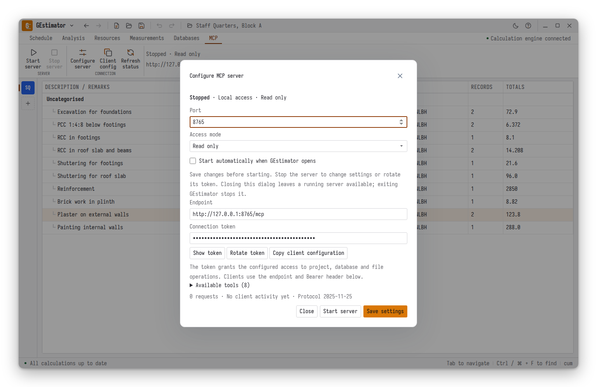

The assistant reads database notes before choosing items, searches databases, imports items, edits analyses and records measurements. Every change it makes appears in the open project at once and is one undo step, so you can review it like your own edits. The server listens only on your computer, and only clients with the connection token can use it.

### Ask for an estimate

GEstimator gives the assistant estimation guides (skills) for civil measurement, electrical measurement and preliminary lighting design. The assistant reads the guide that fits your request before it measures and chooses items. Ask in plain words, for example:

- "Using DSR 2023, take off the brickwork and plaster for the ground floor from plan A-101 and propose BOQ items. Show me the draft first."
- "Count the light and fan points for the first floor from this layout and match them to DSR (E&M) 2025 items."
- "There is no lighting layout yet. Prepare a preliminary lighting design for these offices and draft the electrical estimate."

The assistant first shows draft measurements and proposed items. Each line lists the location, dimensions or count, calculation, source and assumptions. It also flags missing inputs and items that need your decision. It writes to the project only when you ask it to apply the estimate. Lighting design results are marked provisional.

To choose a guide yourself in Claude Code, type `@` and pick the resource, for example `@gestimator:gestimator://skills/civil-measurement-estimation`. The guides are available whenever the server runs, even with no project open.

After adding the server to an AI client, **start a new session** in that client so it loads GEstimator's tools. If the assistant writes its own script to talk to the server, or builds the estimate in a spreadsheet, the server is not loaded in that session: restart the client and check that GEstimator appears in its MCP server list (for example `claude mcp list` or `codex mcp list`). It also helps to name the guide in the request, for example "use the GEstimator civil measurement skill". Treat the connection token like a password: do not paste it into conversations you share, and use **Rotate token** if it has been exposed.

## 12. Keyboard shortcuts

The full list is under **Keyboard shortcuts** (the `?` icon in the title bar). The most used:

| Action | Keys |
|---|---|
| Open / save / save copy | Ctrl+O / Ctrl+S / Ctrl+Shift+S |
| Find in current view | Ctrl+F |
| New / close project tab, next tab | Ctrl+T / Ctrl+W, Ctrl+Tab |
| Undo / redo | Ctrl+Z / Ctrl+Y |
| Add item, record or resource / add subitem | Ctrl+I / Ctrl+Shift+I |
| Add from database | Ctrl+L |
| Copy / paste / duplicate / delete rows | Ctrl+C / Ctrl+V / Ctrl+D / Delete |
| Move row up / down | Alt+Up / Alt+Down |
| Edit cell / cancel / next cell | Enter or F2 / Escape / Tab |

On macOS use ⌘ in place of Ctrl.
